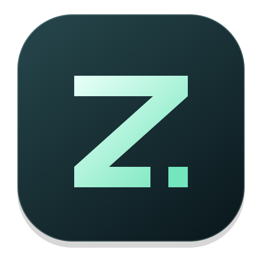

<!--
SPDX-FileCopyrightText: 2026 Eike Hein <hein@kde.org>
SPDX-FileCopyrightText: 2026 Mohamed Elashri <kwi@elashri.com>
SPDX-License-Identifier: CC0-1.0
-->
#  Zirq

[](https://github.com/MohamedElashri/zirq/actions/workflows/checks.yml)
[](https://github.com/MohamedElashri/zirq/releases/latest)
[](https://github.com/MohamedElashri/zirq/releases/latest)
[](LICENSES/)

A Metal-accelerated terminal workspace for Apple Silicon, with bidirectional
Arabic, Persian and Hebrew support. Zirq builds on [KDE Kwi](https://invent.kde.org/utilities/kwi),
Qt Quick, KDE Frameworks and libghostty-vt, with its own macOS integration and features.


- **Tabbed sessions** with searchable scrollback and keyboard selection.
- **Arabic, Persian and Hebrew** with bidirectional rendering, joining and mixed-script copy and search.
- **Mac input** with familiar shortcuts and optional Option-as-Alt.
- **Your workspace** with launch presets, color schemes, fonts and configurable shortcuts.

## Install

An Apple Silicon Mac is required; see the release notes for the minimum macOS version.
Install or update the latest stable release:

```sh
curl -fsSL https://raw.githubusercontent.com/MohamedElashri/zirq/main/install.sh | bash
```

Run the same command again to update. The installer verifies checksums and
signatures and installs to `/Applications` or `~/Applications` without sudo.
Quit Zirq and use another terminal when updating. For a custom destination, replace
`bash` with `bash -s -- --app-dir "$HOME/Applications"`.

**Homebrew** uses this repository as its tap:

```sh
brew tap MohamedElashri/zirq https://github.com/MohamedElashri/zirq.git
brew install --cask mohamedelashri/zirq/zirq
```

Update a Homebrew installation with:

```sh
brew update
brew upgrade --cask mohamedelashri/zirq/zirq
```

For manual installation, download the app archive from the
[latest release](https://github.com/MohamedElashri/zirq/releases/latest)
and move the included app to Applications. The first Zirq release uses
**Zirq-arm64.zip**; version 0.2.0 still uses **Kwi-arm64.zip**.

Builds are ad-hoc signed and not notarized. If macOS blocks the first launch,
follow [Apple’s Open Anyway instructions](https://support.apple.com/en-us/102445).

The first Zirq source version is 0.3.0. Until it is published, the installer and
Homebrew continue to verify the existing 0.2.0 Kwi archive; Homebrew installs it
as `Zirq.app`. The next release switches to the new Zirq bundle automatically.

## Upgrading from Kwi Mac

Zirq uses the same preferences, presets, color schemes and shortcut collections,
so your existing profile carries over. The installer recognizes `Kwi.app` and
replaces it with `Zirq.app`, with rollback if replacement fails. Homebrew tracks
the `kwi-mac` → `zirq` cask rename through this tap.

Quit Kwi before upgrading. Preferences carry over; running tabs, processes and
terminal scrollback do not resume after quitting. Shell history remains managed
by your shell. Permissions associated with the old macOS app identity are
outside this profile migration.

The project now lives at `MohamedElashri/zirq`. Existing GitHub repository and
release links redirect to the new location. Update a local checkout with:

```sh
git remote set-url origin https://github.com/MohamedElashri/zirq.git
```

For an existing Homebrew installation, add the new tap before upgrading. The
new tap includes the old cask token in its rename map:

```sh
brew tap MohamedElashri/zirq https://github.com/MohamedElashri/zirq.git
brew update
brew upgrade --cask mohamedelashri/zirq/zirq
```

After the upgrade succeeds, the old tap can be removed with
`brew untap MohamedElashri/kwi-mac`.

Re-add Zirq to the Dock and update any custom launchers or shell aliases that
refer to `Kwi.app` or its `kwi` executable.

## Use

**⌘T** opens a tab, **⌘F** searches output, and **⌘,** opens settings.
Enable **Use Option as Alt** under **Behavior** when needed.

Bidirectional rendering is enabled by default. For applications that already
arrange RTL text themselves, turn it off under **Terminal → Text direction**.

## Development

Zirq has its own versions, releases and support, maintained by
[Mohamed Elashri](https://github.com/MohamedElashri). We regularly review KDE Kwi
updates and integrate them through tested pull requests.

See [Development.md](Development.md) for building, testing, releases and maintenance.
Local development and CI use the same [Makefile](Makefile).

## License

The application is GPL-2.0-only OR GPL-3.0-only OR LicenseRef-KDE-Accepted-GPL;
the terminal libraries are LGPL-2.1-only OR LGPL-3.0-only OR
LicenseRef-KDE-Accepted-LGPL. Konsole palettes are GPL-2.0-or-later. See
[license texts](LICENSES/) and [palette attribution](libs/kwi-terminal/data/color-schemes/NOTICE).
