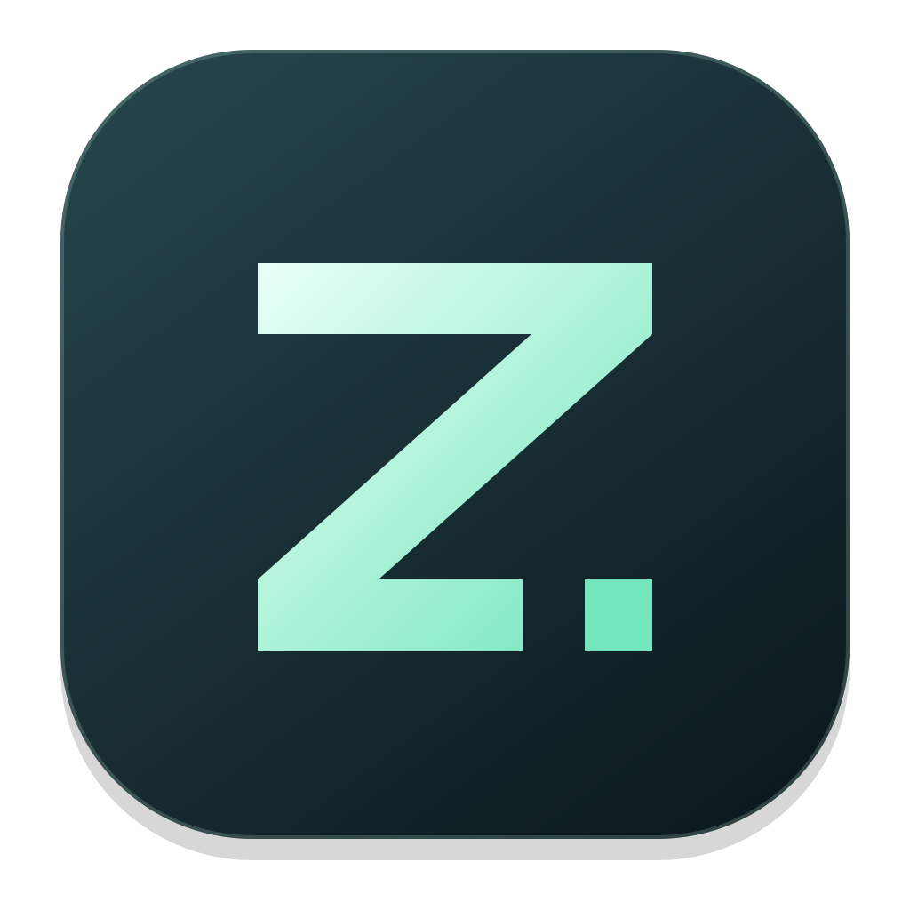
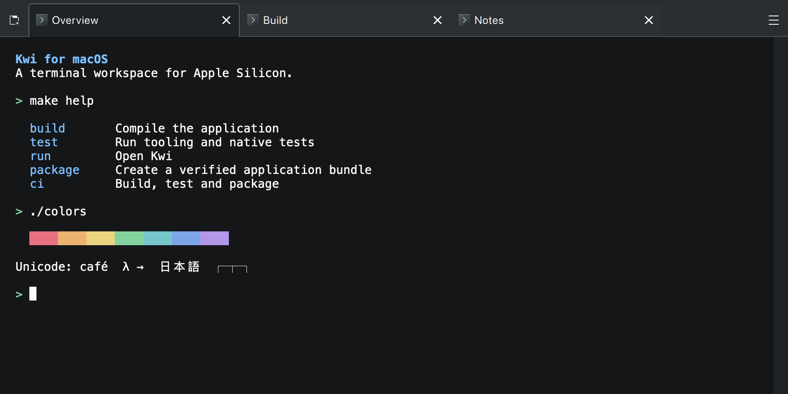

<!--
SPDX-FileCopyrightText: 2026 Eike Hein <hein@kde.org>
SPDX-FileCopyrightText: 2026 Mohamed Elashri <kwi@elashri.com>
SPDX-License-Identifier: CC0-1.0
-->
#  Kwi Mac

[](https://github.com/MohamedElashri/kwi-mac/actions/workflows/checks.yml)
[](https://github.com/MohamedElashri/kwi-mac/releases/latest)
[](https://github.com/MohamedElashri/kwi-mac/releases/latest)
[](LICENSES/)

A Metal-accelerated terminal for Apple Silicon. An independently maintained
macOS fork of [KDE Kwi](https://invent.kde.org/utilities/kwi), with bidirectional
Arabic, Persian and Hebrew support. Built with Qt Quick, KDE Frameworks and libghostty-vt.



- **Tabbed sessions** with searchable scrollback and keyboard selection.
- **Arabic, Persian and Hebrew** with bidirectional rendering, joining and mixed-script copy and search.
- **Mac input** with familiar shortcuts and optional Option-as-Alt.
- **Your workspace** with launch presets, color schemes, fonts and configurable shortcuts.

## Install

Download **Kwi-arm64.zip** from the [latest release](https://github.com/MohamedElashri/kwi-mac/releases/latest),
extract it, and move **Kwi.app** to Applications. An Apple Silicon Mac is required;
see the release notes for the minimum macOS version.

Builds are ad-hoc signed and not notarized. If macOS blocks the first launch,
follow [Apple’s Open Anyway instructions](https://support.apple.com/en-us/102445).
For a trusted download, you can also remove its quarantine attribute:

```sh
xattr -dr com.apple.quarantine /Applications/Kwi.app
```

Adjust the path if you installed the app elsewhere.

## Use

**⌘T** opens a tab, **⌘F** searches output, and **⌘,** opens settings.
Enable **Use Option as Alt** under **Behavior** when needed.

Bidirectional rendering is enabled by default. For applications that already
arrange RTL text themselves, turn it off under **Terminal → Text direction**.

## Development

Kwi Mac has its own versions, releases and support, maintained by
[Mohamed Elashri](https://github.com/MohamedElashri). We regularly review KDE Kwi
updates and integrate them through tested pull requests.

See [Development.md](Development.md) for building, testing, releases and maintenance.
Local development and CI use the same [Makefile](Makefile).

## License

The application is GPL-2.0-only OR GPL-3.0-only OR LicenseRef-KDE-Accepted-GPL;
the terminal libraries are LGPL-2.1-only OR LGPL-3.0-only OR
LicenseRef-KDE-Accepted-LGPL. Konsole palettes are GPL-2.0-or-later. See
[license texts](LICENSES/) and [palette attribution](libs/kwi-terminal/data/color-schemes/NOTICE).
